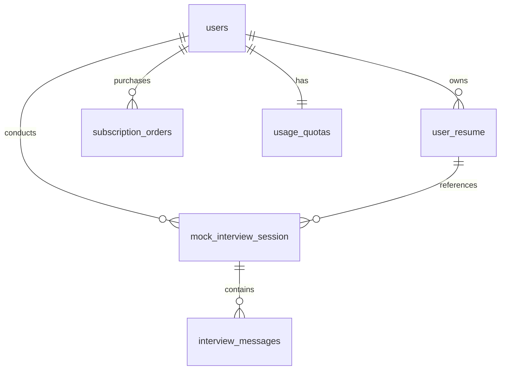

# 数据库设计

## ER 关系

目录表 `industry_catalog` / `enterprise_catalog` 独立维护，不直接外键关联用户数据；面试会话的 `industry`、`interviewer_role`（名企为 `enterprise:{id}`）按 id 引用。

## 表说明

### users
| 字段 | 类型 | 说明 |
|------|------|------|
| id | INTEGER PK | 用户 ID |
| email | TEXT UNIQUE | 邮箱 |
| display_name | TEXT | 显示名 |
| password_hash | TEXT | 本地登录密码哈希 |
| plan_tier | TEXT | `free` / `membership_pass`（付费通行证；不再使用 monthly/quarterly） |
| platform_user_id | TEXT | Platform 侧用户 id |
| created_at | TEXT | 创建时间 |

### user_resume（PRD 5.1 扩展）
| 字段 | 类型 | 说明 |
|------|------|------|
| id | INTEGER PK | 简历 ID |
| user_id | INTEGER FK | 所属用户 |
| resume_title | TEXT | 标题；上传时若仍为「我的简历」则用原始文件名（去后缀） |
| target_job_title | TEXT | 目标岗位 |
| job_description | TEXT | 目标 JD |
| original_file_name | TEXT | 原始文件名 |
| stored_file_path | TEXT | `UPLOAD_DIR` 下的存储文件名 |
| file_mime_type | TEXT | 上传 MIME |
| parsed_json | TEXT | 解析结果 JSON |
| score_overall / score_clarity / score_competitiveness / score_match / score_professionalism | INTEGER | 多维度评分 |
| match_percentage | INTEGER | JD 匹配百分比 |
| missing_keywords | TEXT | 缺失关键词 JSON |
| jd_match_report | TEXT | JD 匹配说明 |
| diagnosis_report | TEXT | 诊断报告 |
| star_suggestions | TEXT | STAR 重写 JSON |
| analysis_status | TEXT | 分析状态（默认 `complete`） |
| created_at / updated_at | TEXT | 时间戳 |

删除简历时：校验归属；从 `UPLOAD_DIR` 删除 `stored_file_path`；将引用该简历的 `mock_interview_session.resume_id` 置空后再删行。

### mock_interview_session（PRD 5.2 扩展）
| 字段 | 类型 | 说明 |
|------|------|------|
| id | INTEGER PK | 会话 ID |
| user_id | INTEGER FK | 用户 |
| resume_id | INTEGER FK | 关联简历，可空 |
| interviewer_role | TEXT | `hr` / `technical` / `pressure` / `english` / `enterprise:{companyId}` |
| industry | TEXT | 行业目录 id |
| mode | TEXT | text / voice |
| status | TEXT | active / completed |
| difficulty | TEXT | easy / standard / hard |
| target_job_title | TEXT | 本场目标岗位 |
| question_count | INTEGER | 已发出的面试官题目数 |
| total_duration_sec | INTEGER | 时长 |
| score_logic / score_professional / score_expression / score_match / score_confidence | INTEGER | 复盘分数 |
| feedback_summary | TEXT | 总评 |
| report_json | TEXT | 完整复盘报告 |
| recording_path | TEXT | 语音面试录音路径 |
| started_at / ended_at | TEXT | 起止时间 |

HR / 压力 / 英文每场 **8** 题，技术面 **10** 题；名企按题库长度，浅答最多再插 2 次【追问】。

### interview_messages
| 字段 | 类型 | 说明 |
|------|------|------|
| session_id | INTEGER FK | 面试会话 |
| role | TEXT | user / assistant |
| content | TEXT | 消息内容 |
| message_type | TEXT | text / voice |
| score_json | TEXT | 单题评估 JSON |
| created_at | TEXT | 创建时间 |

### subscription_orders
| 字段 | 类型 | 说明 |
|------|------|------|
| plan_type | TEXT | 套餐码（如 membership / enterprise_pack） |
| amount_cents | INTEGER | 金额（分） |
| status | TEXT | pending / paid / expired |
| paid_at | TEXT | 支付时间 |
| expires_at | TEXT | 会员到期时间 |
| created_at | TEXT | 创建时间 |

### usage_quotas
| 字段 | 类型 | 说明 |
|------|------|------|
| resume_diagnosis_used | INTEGER | 已用简历诊断次数 |
| mock_interview_used | INTEGER | 已用模拟面试次数 |
| reanalyze_used | INTEGER | 已用重新分析次数 |
| enterprise_credits | INTEGER | 名企冲刺剩余次数 |
| reset_at | TEXT | 配额重置时间 |

### industry_catalog
| 字段 | 类型 | 说明 |
|------|------|------|
| id | TEXT PK | 行业 id（如 `internet_rd`） |
| name | TEXT | 中文名 |
| sort_order | INTEGER | 排序 |
| active | INTEGER | 是否上架 |

### enterprise_catalog
| 字段 | 类型 | 说明 |
|------|------|------|
| id | TEXT PK | 公司 id（如 `bytedance`） |
| name | TEXT | 公司名 |
| industry | TEXT | 所属行业 |
| description | TEXT | 简介 |
| questions_json | TEXT | 真题列表 JSON |
| active | INTEGER | 是否上架 |

## 商业化配额（代码逻辑）

付费判断以 Platform 权益 `membership_pass` 或本地 `users.plan_tier = 'membership_pass'` 为准（见 `has_active_membership_pass`），不是 monthly/quarterly。

| plan_tier | 简历诊断 | 模拟面试 |
|-----------|----------|----------|
| free | 1 次 | 1 次（5 分钟） |
| membership_pass | 无限 | 无限 |
